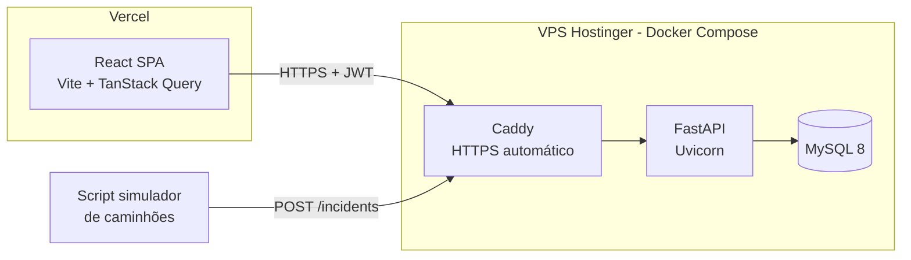

# PRD — Logos: Central de Resposta a Incidentes (MVP)

> Case prático — Desenvolvedor Fullstack
> Autor: Bruno Coitinho Pereira
> Início: 20/10/2026 · **Prazo: 21/10/2026 às 23h59** · Meta interna: entregar até 22h00

---

## 1. Contexto do problema

Um grande grupo de logística opera **5.000 caminhões** em rota. Hoje a comunicação entre os caminhões e a central de decisão acontece por **WhatsApp e planilhas manuais** que não se conversam. Resultado: horas para reagir a um pneu furado ou a um bloqueio de estrada, e milhões perdidos por ano.

O **Logos** é o MVP da plataforma que centraliza esses incidentes. É uma **ferramenta de missão crítica**, usada por analistas sob muita pressão.

### Persona principal — Analista da Central

- Monitora dezenas ou centenas de incidentes ao mesmo tempo.
- Precisa saber **em milissegundos** o que é mais urgente.
- Trabalha em equipe: dois analistas **não podem** atuar no mesmo incidente sem saber.
- Não pode perder trabalho nem ficar sem saber se uma ação foi salva quando a rede oscila.

### Dores que o MVP resolve

| Dor atual | Resposta do Logos |
|---|---|
| Informação espalhada (WhatsApp/planilhas) | API única de ingestão + painel único |
| Não se sabe o que é prioridade | Ordenação por prioridade + design de gestão por exceção |
| Dois analistas atuam no mesmo caso | "Assumir incidente" atômico + controle de versão (409 Conflict) |
| Ninguém sabe quem fez o quê | Responsável visível + histórico de eventos |
| Rede instável trava o trabalho | Retry, cache, update otimista com rollback, aviso de offline |

---

## 2. Requisitos do case (fonte: enunciado do case)

### 2.1 Funcionais obrigatórios

- **RF01 — Ingestão e visualização:** API que recebe e serve incidentes com as categorias:
  - Acidente com Veículo
  - Acidente com Vítimas
  - Condição Climática Atípica na Pista
  - Problema Mecânico
  - Bloqueio de Pista
- **RF02 — Visualização de 100 incidentes simultâneos** com identificação de prioridade imediata.
- **RF03 — Gestão por exceção:** filtrar por criticidade (Alta, Média, Baixa) e por categoria.
- **RF04 — Ciclo de vida:** status Aberto, Em Investigação, Fechado, Inconclusivo.
- **RF05 — Integridade:** dois analistas não podem resolver o mesmo incidente ao mesmo tempo.
- **RF06 — Resiliência:** o sistema não quebra quando a conexão oscila; o estado da aplicação é tratado enquanto o banco processa uma atualização.
- **RF07 — CRUD completo** de incidentes com persistência em banco.

### 2.2 Entregáveis

1. Repositório público no GitHub (backend **Python** + frontend **React**), com setup claro e justificativa das escolhas.
2. Vídeo de até **5 minutos** (YouTube não listado ou Drive público): code review + demo (integração front/back, estados loading/erro/vazio, lógica de filtros, segurança básica da API).
3. Link da aplicação no ar, pronta para uso, com instruções na tela inicial.
4. Entrega: **um link público para uma pasta** contendo os três links acima.

### 2.3 Critérios de avaliação (e como cada um será atendido)

| Critério | Como atendemos |
|---|---|
| Histórico de versionamento | Commits pequenos e semânticos por etapa (ver `progress.md`) |
| Organização e modularização | Monorepo `backend/` + `frontend/` + `infra/`, camadas claras |
| Nomenclatura clara | Código em inglês, UI e docs em português |
| Documentação | README com setup, arquitetura (diagrama), decisões técnicas |
| Feedback visual | Skeleton, spinners em botões, toasts, banner offline, "atualizado há X s" |
| Atenção aos detalhes | Design system (shadcn/ui + Tailwind), tipografia e espaçamento consistentes |
| Modo claro/escuro | Toggle com persistência e respeito à preferência do sistema |
| Transições fluidas | Animações curtas em drawer, lista e toasts |
| Design da informação | Ordenação por prioridade, cor + ícone + texto, contadores no topo |
| Robustez e validação | Pydantic v2 em todas as entradas, enums, limites de tamanho, erros padronizados |
| Integridade de dados | Optimistic locking (`version`) + claim atômico + máquina de estados |
| Exceções de rede | Retry com backoff, timeouts, pool com pre-ping, health check, rollback no front |
| Prova de que tudo isso funciona | Matriz de testes automatizados por cenário crítico (§8), rodando no CI |

---

## 3. Escopo

### Dentro do escopo (MVP)

- Login JWT com 3 analistas de demonstração (credenciais exibidas na tela de login).
- CRUD de incidentes.
- Filtros por criticidade, categoria, status e busca textual.
- Assumir / liberar incidente, mudar status com regras de transição.
- Histórico de eventos por incidente (quem mudou o quê e quando).
- Atualização automática da lista (polling).
- Seed com ~100 incidentes realistas (rodovias brasileiras).
- Deploy: API + MySQL na VPS Hostinger (Docker Compose + HTTPS), front na Vercel.

### Fora do escopo

- Mapa em tempo real dos caminhões.
- WebSocket/SSE (polling é suficiente no MVP; ver decisão D7).
- Perfis e permissões avançados (supervisor/admin).
- App mobile do motorista (a ingestão é simulada por script e pelo formulário).
- Recuperação de senha, cadastro de usuários.

---

## 4. Regras de negócio

### 4.1 Prioridade (ordenação padrão da lista)

Ordenação lexicográfica, feita no banco (fácil de explicar e auditar, sem "nota mágica"):

1. **Status:** Aberto antes de Em Investigação (Fechado e Inconclusivo ficam ocultos por padrão).
2. **Criticidade:** Alta → Média → Baixa.
3. **Gravidade da categoria:** Acidente com Vítimas → Acidente com Veículo → Bloqueio de Pista → Condição Climática Atípica → Problema Mecânico.
4. **Tempo de espera:** o mais antigo primeiro.

No formulário de criação, a criticidade é **pré-sugerida** pela categoria (ex.: Acidente com Vítimas → Alta), mas o analista pode alterar.

### 4.2 Máquina de estados

```
            assumir (claim)
  ABERTO ───────────────────► EM INVESTIGAÇÃO
    ▲                            │        │
    │ liberar (release)          │        │
    └────────────────────────────┘        │
    ▲                                     ▼
    │ reabrir              FECHADO / INCONCLUSIVO
    └───────────────────────────────────┘
```

| De | Para | Quem pode |
|---|---|---|
| Aberto | Em Investigação | Qualquer analista (vira responsável) |
| Em Investigação | Aberto | Somente o responsável (liberar) |
| Em Investigação | Fechado / Inconclusivo | Somente o responsável (nota de resolução obrigatória) |
| Fechado / Inconclusivo | Aberto | Qualquer analista (reabrir, com motivo) |

Transição inválida → `422` com mensagem clara. Ação por quem não é responsável → `403`.

### 4.3 Concorrência (o ponto mais importante do case)

Duas camadas complementares:

1. **Claim atômico.** "Assumir" é um único `UPDATE ... WHERE id = :id AND status = 'OPEN' AND assigned_to IS NULL`. Se outro analista assumiu um milissegundo antes, o banco afeta 0 linhas e a API devolve `409 Conflict` informando **quem** assumiu. Não existe janela entre "ler" e "gravar".
2. **Optimistic locking em todas as escritas.** Cada incidente tem a coluna `version`. Toda escrita envia a versão que o cliente viu. O `UPDATE` só acontece se a versão bater, e então incrementa. Se não bater, `409 Conflict` com o estado atual. Implementado com o recurso nativo `version_id_col` do SQLAlchemy.

No front, um `409` gera: rollback da UI otimista, toast "Ana assumiu este incidente antes de você" e recarga do incidente.

> Por que não lock pessimista (`SELECT ... FOR UPDATE`)? Ele segura a linha enquanto o analista pensa. Numa operação com rede instável, isso trava registros. O otimista não segura nada e só falha quando há conflito real, que é raro.

---

## 5. Arquitetura



### 5.1 Backend (Python)

| Item | Escolha | Motivo |
|---|---|---|
| Framework | **FastAPI** | Validação com Pydantic nativa, OpenAPI/Swagger automático, alto desempenho. Já estudado no curso da EBAC |
| ORM | **SQLAlchemy 2.0** (síncrono) + **PyMySQL** | `version_id_col` pronto para optimistic locking; síncrono é mais simples de explicar e o FastAPI roda em threadpool |
| Migrações | **Alembic** | Esquema versionado junto com o código |
| Validação | **Pydantic v2** | Enums, limites de tamanho, tipos estritos, mensagens padronizadas |
| Auth | **JWT** (PyJWT) + **bcrypt** | Stateless, simples de demonstrar |
| Resiliência | `pool_pre_ping`, `pool_recycle`, timeouts, retry com backoff (`tenacity`) em falhas transitórias de conexão | Lidar com lentidão/queda do banco |
| Rate limit | `slowapi` no login | Segurança básica contra força bruta |
| Testes | **pytest** + `httpx` TestClient | Incluindo teste de concorrência (dois claims → um 409) |
| Qualidade | **Ruff** (lint + format) | Rápido, padrão atual |

Estrutura:

```
backend/
  app/
    main.py              # cria app, middlewares, handlers de erro
    core/                # config (pydantic-settings), security (JWT, hash), errors
    db/                  # engine, session, base
    models/              # SQLAlchemy: User, Incident, IncidentEvent
    schemas/             # Pydantic: entrada e saída
    services/            # regras de negócio: transições, claim, filtros
    api/
      deps.py            # get_db, get_current_user
      routes/            # auth.py, incidents.py, health.py
  alembic/
  scripts/
    seed.py              # 3 analistas + ~100 incidentes
    simulate_trucks.py   # envia incidentes periodicamente (demo)
  tests/
  Dockerfile
  pyproject.toml
```

### 5.2 Modelo de dados

**users:** `id`, `name`, `email` (único), `password_hash`, `created_at`

**incidents:**

| Campo | Tipo | Observação |
|---|---|---|
| id | int PK | |
| title | varchar(120) | obrigatório |
| description | text | até 2.000 caracteres |
| category | enum | 5 categorias do case |
| criticality | enum | HIGH, MEDIUM, LOW |
| status | enum | OPEN, INVESTIGATING, CLOSED, INCONCLUSIVE |
| vehicle_plate | varchar(8) | placa Mercosul validada por regex |
| highway | varchar(20) | ex.: BR-116 |
| km | decimal(6,1) | |
| city / state | varchar | UF validada |
| reported_at | datetime | momento do incidente |
| assigned_to_id | FK users, null | responsável |
| assigned_at | datetime, null | |
| resolution_note | text, null | obrigatório ao fechar |
| version | int | optimistic locking |
| created_at / updated_at | datetime | |
| deleted_at | datetime, null | soft delete |

Índices: `(status, criticality)`, `category`, `reported_at`.

**incident_events:** `id`, `incident_id`, `user_id`, `type` (CREATED, CLAIMED, RELEASED, STATUS_CHANGED, UPDATED, REOPENED), `from_status`, `to_status`, `note`, `created_at`.

### 5.3 Endpoints

| Método | Rota | Descrição |
|---|---|---|
| POST | `/api/auth/login` | Retorna JWT (rate limited) |
| GET | `/api/auth/me` | Usuário logado |
| GET | `/api/incidents` | Lista com filtros: `status`, `criticality`, `category` (múltiplos), `q`, `limit`, `offset` |
| GET | `/api/incidents/summary` | Contadores por criticidade/status (cards do topo) |
| GET | `/api/incidents/{id}` | Detalhe |
| GET | `/api/incidents/{id}/events` | Histórico |
| POST | `/api/incidents` | Cria (aceita header `Idempotency-Key` para evitar duplicado em reenvio) |
| PATCH | `/api/incidents/{id}` | Edita campos (exige `version`) |
| POST | `/api/incidents/{id}/claim` | Assume (exige `version`) |
| POST | `/api/incidents/{id}/release` | Libera (exige `version`) |
| POST | `/api/incidents/{id}/transition` | Muda status (`to_status`, `note`, `version`) |
| DELETE | `/api/incidents/{id}` | Soft delete (exige `version`) |
| GET | `/api/health` | Status da API e do banco |

Formato único de erro:

```json
{ "error": { "code": "CONFLICT", "message": "Incidente já assumido por Ana Souza", "details": { "current": { ... } } } }
```

Códigos: `400/422` validação, `401` sem token, `403` sem permissão, `404` não encontrado, `409` conflito, `429` rate limit, `503` banco indisponível.

### 5.4 Frontend (React)

| Item | Escolha | Motivo |
|---|---|---|
| Base | **Vite + React + TypeScript** | SPA simples, build rápido. Mesmo setup do portfólio |
| Estado de servidor | **TanStack Query** | Ver seção 6 |
| HTTP | **Axios** | Já usado no trabalho; interceptor para JWT e 401 |
| UI | **Tailwind CSS + shadcn/ui** (Radix) | Componentes acessíveis, dark mode nativo; já usado em projetos anteriores |
| Formulários | **React Hook Form + Yup** | Já usados no trabalho |
| Rotas | **React Router** | Login + painel |
| Toasts | **Sonner** | Feedback de ações |
| Ícones | **lucide-react** | Ícone por categoria |
| Testes | **Vitest + Testing Library** | Mesmo setup do portfólio |

Estrutura:

```
frontend/src/
  api/                 # axios client, funções por recurso, tipos
  features/
    auth/              # login page, auth context
    incidents/
      components/      # IncidentList, IncidentRow, FilterBar, SummaryCards, IncidentDrawer, IncidentForm
      hooks/           # useIncidents, useClaimIncident, useTransitionIncident...
      constants.ts     # labels, cores, ícones, ordem de prioridade
  components/ui/       # shadcn
  components/layout/   # header, theme toggle, offline banner
  lib/                 # queryClient, utils, formatters
  routes/
```

### 5.5 Design da informação (gestão por exceção)

- **Filtro padrão:** só Aberto + Em Investigação. Fechados não competem pela atenção.
- **Cards no topo:** "Alta abertas: 7", "Sem responsável: 12", "Em investigação: 9". Clicar aplica o filtro.
- **Linha do incidente**, densa e escaneável:
  - Barra lateral colorida por criticidade (vermelho/âmbar/azul) **+ ícone + texto** (nunca só cor, por acessibilidade).
  - Ícone da categoria, título, rodovia/km, placa.
  - **Tempo de espera vivo** ("há 14 min"), que fica destacado quando passa de um limite.
  - Badge de status + avatar do responsável ("Em investigação — Ana").
  - Alta + Acidente com Vítimas sem responsável: indicador pulsante discreto.
- **Filtros como chips** com contagem, sincronizados com a URL (link compartilhável, sobrevive ao F5).
- **Drawer lateral** para o detalhe e as ações, sem perder a lista de vista.
- 100 linhas renderizam bem sem virtualização. Se passar de algumas centenas, a evolução é `@tanstack/react-virtual`.

### 5.6 Estados de interface (exigidos no vídeo)

| Estado | Tratamento |
|---|---|
| Loading inicial | Skeleton das linhas e dos cards |
| Refetch em segundo plano | Indicador discreto "Atualizando…" + "atualizado há X s"; a lista continua visível |
| Mudança de filtro | Mantém os dados anteriores enquanto carrega (`placeholderData`), sem piscar |
| Ação em andamento | Botão com spinner e desabilitado (evita duplo clique) |
| Erro de rede | Toast + botão "Tentar novamente"; dados em cache continuam na tela |
| Offline | Banner fixo "Sem conexão — exibindo últimos dados"; ações bloqueadas com explicação |
| Conflito (409) | Rollback + toast explicando quem agiu antes + recarga |
| Vazio | Ilustração + "Nenhum incidente com esses filtros" + "Limpar filtros" |
| Sessão expirada (401) | Volta para o login com aviso |

---

## 6. Por que TanStack Query (argumento para o vídeo)

**A ideia central:** existem dois tipos de estado.

- **Estado do cliente:** tema escuro, drawer aberto, texto digitado. Vive só no navegador. `useState`/Context resolvem.
- **Estado do servidor:** a lista de incidentes. O "dono" é o banco; o front tem apenas uma **cópia** que pode ficar desatualizada a qualquer momento, porque outro analista mudou algo ou a rede caiu.

Redux foi feito para o primeiro tipo. Para o segundo, eu teria que escrever à mão: loading, erro, cache, recarga periódica, retry, cancelamento e rollback. O TanStack Query é uma biblioteca especializada exatamente nisso.

O que ele entrega e qual requisito do case cada recurso atende:

| Recurso | Requisito do case |
|---|---|
| `isPending`, `isError`, `isFetching` prontos | Feedback visual: loading / erro / vazio |
| `retry` com backoff exponencial | Rede oscilando não quebra a tela |
| Cache: os dados antigos continuam visíveis se a recarga falhar | "Não quebrar se a conexão oscilar" |
| `refetchInterval` (polling) e `refetchOnWindowFocus` | Lista sempre atualizada com o trabalho dos outros analistas |
| `onMutate` / `onError` / `onSettled` | **Update otimista com rollback**: a UI responde na hora e desfaz se o banco recusar |
| `placeholderData: keepPreviousData` | Trocar filtro sem piscar a tela |
| `onlineManager` | Pausa requisições offline e retoma quando a rede volta |
| Devtools | Mostrar o cache ao vivo no vídeo |

**Comparação honesta com o que já uso:**

- *Redux + Axios (uso no trabalho):* funciona, mas cada um desses recursos vira código meu, mais superfície de bug num prazo de 2 dias.
- *RTK Query:* equivalente em recursos e da família Redux, mas mais verboso e acoplado a uma store global que este projeto não precisa.
- *TanStack Query:* menos código, padrão de mercado, e continuo usando **Axios** dentro dele, então a camada HTTP é a que já conheço.

**Trade-off assumido:** é uma dependência nova para mim. Mitigação: uso só o essencial (`useQuery`, `useMutation`, `queryClient.invalidateQueries`, `setQueryData`).

**Frase-resumo para o vídeo:** *"O Redux guarda o que o meu front decide. O TanStack Query gerencia uma cópia do que o servidor decide. Ele sabe quando essa cópia está velha, como recarregar e como desfazer quando o servidor diz não."*

---

## 7. Segurança básica

- Senhas com bcrypt; JWT com expiração (8 h) e segredo via variável de ambiente.
- Todas as rotas de incidentes exigem token.
- CORS restrito ao domínio da Vercel (e localhost em dev).
- Rate limit no login.
- Validação estrita de entrada (Pydantic): tamanho máximo, enums, regex de placa e UF; campos extras rejeitados.
- ORM com parâmetros, sem SQL concatenado (proteção contra SQL injection).
- Erros internos nunca vazam stack trace para o cliente.
- Na VPS: MySQL **sem porta exposta** (só rede interna do Docker), firewall `ufw` liberando apenas 22/80/443, `.env` fora do Git.
- ⚠️ O Docker escreve regras próprias de iptables e **ignora o ufw** para portas publicadas. Regra: no compose de produção, só o Caddy tem `ports:`; API e MySQL não publicam porta nenhuma.

---

## 8. Estratégia de testes

**Princípio:** cada cenário que o case destaca tem pelo menos um teste automatizado que o **prova**. Os testes são escritos **na mesma etapa** da funcionalidade, não no fim; os IDs abaixo aparecem no checklist do `progress.md`.

### 8.1 Camadas

| Camada | Ferramenta | Volume | Observação |
|---|---|---|---|
| Backend: integração da API + serviços | pytest + TestClient | Maior parte | Contra **MySQL real** em Docker, e não SQLite: atomicidade do `UPDATE`, enums e locks se comportam diferente |
| Frontend: componentes e hooks | Vitest + Testing Library + **MSW** | Médio | Simula 409, 500, lentidão e queda de rede |
| Ponta a ponta | **Playwright** | Poucos, só fluxos críticos | Inclui conflito com **dois navegadores** |

### 8.2 Matriz cenário → teste

**Concorrência (critério "Integridade de Dados"), o grupo mais importante**

| ID | Cenário | Resultado esperado |
|---|---|---|
| C1 | 10 threads tentam `claim` no mesmo incidente ao mesmo tempo (sincronizadas com `threading.Barrier`) | Exatamente **1** resposta 200 e **9** respostas 409; no banco, 1 responsável e 1 evento `CLAIMED` |
| C2 | `PATCH` com `version` desatualizada | 409 com o estado atual no corpo; registro inalterado |
| C3 | Duas transições com a mesma `version` | Uma 200, outra 409 |
| C4 | Analista que não é o responsável tenta fechar | 403 |
| C5 | `DELETE` com `version` antiga | 409 |
| C6 | `POST` repetido com o mesmo `Idempotency-Key` (reenvio após queda de rede) | Mesmo incidente devolvido, sem duplicar |

**Ciclo de vida**

| ID | Cenário | Resultado esperado |
|---|---|---|
| L1 | Cada transição válida da tabela §4.2 (parametrizado) | 200 + evento registrado com from/to |
| L2 | **Todas** as combinações fora da tabela (geradas automaticamente) | 422 |
| L3 | Fechar ou marcar Inconclusivo sem nota | 422 |

**Validação e robustez (critério "não quebrar com informações inesperadas")**

| ID | Cenário | Resultado esperado |
|---|---|---|
| V1 | Categoria, criticidade ou status fora dos enums | 422 |
| V2 | Campos extras, textos acima do limite, placa e UF inválidas | 422 com o campo indicado |
| V3 | JSON malformado, corpo vazio, tipos errados | 422 no formato padrão, **sem stack trace** |
| V4 | ID inexistente / ID não numérico | 404 / 422 |
| V5 | *(diferencial)* Schemathesis gera centenas de requisições aleatórias a partir do OpenAPI | Nenhuma resposta 500 |

**Filtros e prioridade (critério "gestão por exceção")**

| ID | Cenário | Resultado esperado |
|---|---|---|
| F1 | Cada criticidade, cada categoria e combinações múltiplas | Somente os itens correspondentes |
| F2 | Massa de dados controlada | **Ordem exata** da regra §4.1 |
| F3 | Filtro padrão | Exclui Fechado/Inconclusivo; excluídos (soft delete) nunca aparecem |
| F4 | `/summary` | Contadores batem com a contagem real |
| F5 | `limit` acima do máximo / negativo | 422 |

**Segurança básica**

| ID | Cenário | Resultado esperado |
|---|---|---|
| S1 | Sem token, token expirado, assinatura inválida | 401 |
| S2 | Senha errada / e-mail inexistente | Mesma mensagem 401 (não revela se o e-mail existe) |
| S3 | Muitas tentativas de login | 429 |
| S4 | Origem fora da lista de CORS | Sem header `Access-Control-Allow-Origin` |

**Resiliência do backend (critério "exceções de rede")**

| ID | Cenário | Resultado esperado |
|---|---|---|
| R1 | Banco indisponível (sessão que lança `OperationalError`) | 503 no formato padrão |
| R2 | Falha transitória uma vez, depois sucesso | O retry resolve; resposta 200 |
| R3 | `/health` com o banco fora | Reporta `db: down` |

**Frontend (MSW)**

| ID | Cenário | Resultado esperado |
|---|---|---|
| FE1 | Carregamento | Skeleton, depois a lista |
| FE2 | Erro 500 / falha de rede | Mensagem + "Tentar novamente" funcionando |
| FE3 | Resposta vazia | Estado vazio + "Limpar filtros" |
| FE4 | 100 incidentes | O primeiro é Alta + Acidente com Vítimas; criticidade com **texto + ícone**, não só cor |
| FE5 | Clicar em chip de filtro | URL atualizada + parâmetros corretos enviados à API |
| FE6 | Assumir incidente | UI muda **antes** da resposta (otimista); 409 → rollback + toast com o nome de quem assumiu |
| FE7 | Erro de rede na ação | Rollback + toast; botão desabilitado durante o envio (sem duplo clique) |
| FE8 | Navegador offline | Banner + ações bloqueadas com explicação |
| FE9 | Resposta 401 | Volta para o login |
| FE10 | Alternar tema | Classe aplicada + preferência persistida |

**Ponta a ponta (Playwright)**

| ID | Cenário | Resultado esperado |
|---|---|---|
| E1 | Login → painel → filtrar → abrir detalhe | Fluxo completo sem erro |
| E2 | **Ana e Bruno, em dois contextos de navegador, clicam "Assumir" no mesmo incidente** | Um vê sucesso, o outro vê o aviso de conflito com o nome de quem assumiu |
| E3 | Assumir → fechar com nota | Incidente some do filtro padrão |

### 8.3 Metas

- Cobertura **≥ 90%** em `backend/app/services` e `backend/app/api`, e nos hooks de `frontend/src/features/incidents`. É o mesmo critério que aplico no trabalho. Componentes puramente visuais não entram na meta.
- CI no GitHub Actions: backend com MySQL como *service container* + frontend, com badge no README.
- E2E roda localmente com `docker compose`; no CI, só se sobrar tempo.

### 8.4 Ferramentas novas e por que usá-las

- **MSW (Mock Service Worker):** intercepta as requisições na camada de rede. Assim o teste exercita o código real (Axios + TanStack Query) e só a "resposta do servidor" é falsa. Com `vi.mock('axios')` o teste ficaria acoplado à implementação e não testaria retry nem rollback de verdade.
- **Playwright:** abre dois contextos de navegador isolados no mesmo teste, que é exatamente o cenário "dois analistas ao mesmo tempo". O Cypress não suporta bem duas sessões simultâneas.
- **Schemathesis** (opcional): lê o OpenAPI que o FastAPI já gera e dispara entradas inesperadas automaticamente. É a prova objetiva de "não quebra com dados inesperados".

---

## 9. Deploy

### 9.0 Ambiente disponível

- VPS Hostinger **KVM 2**, **Ubuntu 26.04 LTS**, com **Docker 29.7 + Compose v5** já instalados. Portas 80/443 livres (verificado em 20/10/2026).
- ⚠️ **A VPS expira em 02/11/2026.** O processo seletivo pode avaliar depois disso. Renove ou garanta que fique no ar até o fim do processo, senão o link entregue cai.
- Plano B de HTTPS, caso o domínio demore a ativar: o hostname padrão da Hostinger (`srvXXXXXX.hstgr.cloud`) já aponta para a VPS e aceita certificado Let's Encrypt no Caddy.
- O IP da VPS **não** vai para o repositório; ele aparece só em `.env` e no painel.

### 9.1 Sua ideia (API + banco na VPS Hostinger, front na Vercel): é uma boa ideia?

**Sim, com cuidados.** Pontos a favor:

- Mostra Docker, proxy reverso, HTTPS, DNS e Linux, um diferencial real para um estágio/júnior.
- A VPS não hiberna. Render/Heroku free têm cold start de ~50 s, e o avaliador pode achar que está quebrado.
- O MySQL fica junto da API, com latência baixa.

Riscos e mitigação:

| Risco | Mitigação |
|---|---|
| HTTPS obrigatório (Vercel é HTTPS; API em HTTP é bloqueada pelo navegador) | **Caddy** com certificado Let's Encrypt automático em `api.<seu-dominio>` |
| Ativação de domínio/DNS pode levar horas | **Registrar o domínio e criar o registro A no início do Dia 1** |
| VPS cair durante a avaliação | `restart: unless-stopped` + monitor gratuito (UptimeRobot) no `/api/health` |
| Consome tempo do prazo | Fazer o deploy cedo (fim do Dia 1) com o mínimo funcionando, e não no fim |
| Segurança da VPS | Login por chave SSH, firewall (ufw), banco não exposto |

Plano B se a VPS travar: API no Render/Railway com MySQL gerenciado, documentado no README.

### 9.2 Topologia final

- `https://logos.<dominio>` → Vercel (domínio customizado gratuito na Vercel; opcional, a URL `.vercel.app` também serve)
- `https://api.<dominio>` → VPS: Caddy → FastAPI → MySQL
- `infra/docker-compose.prod.yml` + `infra/Caddyfile` versionados no repositório.

---

## 10. Plano de execução

Prazo: **21/10/2026 às 23h59**. Meta interna: **tudo entregue até 22h00**, deixando 2 h de folga para imprevistos (upload do vídeo, link quebrado).

| Bloco | Entrega |
|---|---|
| **20/10 — tarde** | DNS + repo · backend: esqueleto, models, migrações, infra de testes, seed, CRUD, filtros (+ testes F/V) |
| **20/10 — noite** | Auth JWT (+ S) · claim/transições/optimistic lock (+ **C**, L, R) · **deploy da API na VPS** |
| **21/10 — manhã** | Front: esqueleto, login, lista priorizada, filtros, dark mode, estados (+ FE1–FE5, FE9, FE10) |
| **21/10 — tarde** | Ações otimistas + 409 · polling + offline (+ FE6–FE8) · formulário · deploy Vercel + CI · README |
| **21/10 — noite (até 22h)** | E2E do conflito (E2) · roteiro + gravação do vídeo · testes em aba anônima · pasta de entrega |

### 10.1 Ordem de corte (se atrasar, cortar de baixo para cima)

Nunca cortar: requisitos obrigatórios, testes C/L/V, deploy, README e vídeo.

1. Schemathesis (V5)
2. E2E rodando no CI
3. E2E E1 e E3 (manter o **E2**, que prova o conflito)
4. Domínio próprio do front (`.vercel.app` serve)
5. `Idempotency-Key` (C6)
6. Edição de incidente no front (manter a criação)
7. Timeline de eventos no drawer (manter o registro no backend)

O detalhamento passo a passo, com as mensagens de commit sugeridas, está em [`progress.md`](./progress.md).

---

## 11. Roteiro do vídeo (≤ 5 min)

| Tempo | Conteúdo |
|---|---|
| 0:00–0:30 | Problema do cliente e o que é o Logos |
| 0:30–1:30 | Demo: login, lista priorizada, cards, filtros (mostrar a URL mudando), dark mode |
| 1:30–2:30 | **Conflito ao vivo:** duas janelas lado a lado, dois analistas clicam "Assumir"; um recebe o aviso de conflito |
| 2:30–3:15 | Resiliência: DevTools em "Offline"/"Slow 3G" → banner, dados em cache, retry, rollback |
| 3:15–4:30 | Code review: `services/incidents.py` (claim atômico + version), **teste C1 rodando (10 threads → 1 vencedor)**, schemas Pydantic, hook de mutation otimista, por que TanStack Query |
| 4:30–5:00 | Arquitetura de deploy (diagrama) e próximos passos (WebSocket, mapa, SLA) |

---

## 12. Riscos gerais

| Risco | Mitigação |
|---|---|
| Prazo curto | Ordem de prioridade: requisitos obrigatórios + testes C/L/V → deploy → diferenciais (Schemathesis, E2E no CI) |
| VPS expira em 02/11/2026 | Renovar antes, ou manter o plano B pronto |
| Tecnologia nova (TanStack Query) | Uso mínimo e documentado; seção 6 serve de base para a defesa |
| Avaliador não consegue logar | Credenciais demo visíveis na tela de login e no README |
| Histórico de commits fraco | Um commit por etapa do `progress.md` |
| Código gerado com IA difícil de defender | Revisar cada etapa antes do commit; seção "Uso de IA" transparente no README |

---

## 13. Próximos passos pós-MVP (citar no vídeo)

- WebSocket/SSE para push em tempo real no lugar do polling.
- Mapa com a posição dos caminhões e clusters de incidentes.
- SLA por criticidade com alertas sonoros.
- Perfis (supervisor pode reatribuir incidentes).
- Ingestão via fila (RabbitMQ/SQS) para picos de 5.000 caminhões.
