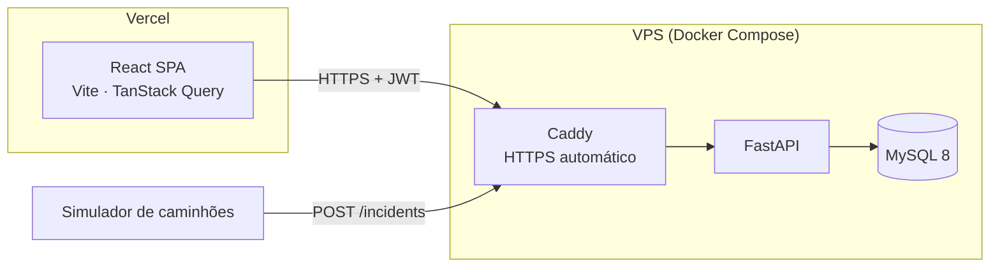

# Logos — Central de Resposta a Incidentes

[](https://github.com/brunocoitinho/logos/actions/workflows/backend.yml)
[](https://github.com/brunocoitinho/logos/actions/workflows/frontend.yml)

MVP de uma plataforma que centraliza e prioriza os incidentes de uma frota de 5.000 caminhões, substituindo a operação via WhatsApp e planilhas manuais. Feita para analistas sob pressão: o mais urgente aparece primeiro, e dois analistas nunca resolvem o mesmo incidente ao mesmo tempo.

| | |
|---|---|
| **Aplicação** | https://logos.startbc.online |
| **API (Swagger)** | https://logos-api.startbc.online/docs |
| **Vídeo** | [LINK_DO_VIDEO](https://youtu.be/iwJxKY33mR8) |

**Acesso de demonstração** (também na tela de login, com um clique): `ana@logos.demo`, `bruno@logos.demo` ou `carla@logos.demo` · senha **`logos2026`**

### Teste em 1 minuto: o conflito entre analistas

1. Abra a aplicação em duas janelas (uma anônima). Entre como **Ana** em uma e **Bruno** na outra.
2. Nas duas, clique no **mesmo incidente** do topo da lista.
3. Clique em **Assumir** na janela da Ana e, em seguida, na do Bruno.
4. O Bruno recebe *"Ana Souza assumiu este incidente antes de você."* e a tela dele passa a mostrar o estado real, sem ações de encerramento.

---

## Como o MVP responde ao desafio

| Desafio | Solução |
|---|---|
| **Identificar a prioridade em milissegundos** entre 100 incidentes | Ordem calculada no banco (status → criticidade → gravidade da categoria → tempo de espera). Criticidade em barra colorida + ícone de formato diferente + texto (nunca só cor). Tempo de espera vivo com **SLA por criticidade**. Card "Alta, sem responsável" acende em vermelho. A interface é neutra: cor só onde há significado |
| **Gestão por exceção** | Fila padrão = Aberto + Em Investigação. Filtros por criticidade, categoria, status e busca, **guardados na URL** (F5, "voltar" e link compartilhável funcionam) |
| **Dois analistas no mesmo incidente** | "Assumir" é um único `UPDATE ... WHERE status = 'OPEN' AND assigned_to_id IS NULL`: só um vence. Demais escritas usam **optimistic locking** (coluna `version`). Conflito vira **409** com o estado atual e o nome de quem agiu antes. Teste com **10 analistas simultâneos**: 1 vencedor, 9 conflitos |
| **Rede oscilando / banco lento** | Front: atualização otimista com **rollback**, retry com espera crescente só para falhas temporárias, dados anteriores mantidos na tela quando a atualização falha, aviso de offline. API: 3 tentativas de conexão, **503** padronizado com o banco fora, `Idempotency-Key` contra reenvios duplicados |

---

## Arquitetura



| Camada | Tecnologias | Por quê |
|---|---|---|
| **Backend** | Python 3.13, FastAPI, SQLAlchemy 2, Alembic, Pydantic v2, MySQL 8, JWT, bcrypt | Validação estrita e Swagger nativos; `version_id_col` do SQLAlchemy para optimistic locking; migrações versionadas |
| **Frontend** | React 19, TypeScript, Vite, TanStack Query, Axios, React Router, React Hook Form + Yup, Tailwind + shadcn/ui | TanStack Query cuida do estado do servidor (cache, polling, retry, rollback); shadcn/ui traz componentes acessíveis (Radix) |
| **Testes** | pytest (MySQL real), Schemathesis, Vitest, Testing Library, MSW, Playwright | Concorrência só se prova no banco real; MSW testa o Axios e o TanStack Query de verdade |
| **Infra** | Docker, Caddy, GitHub Actions, Vercel | Só o Caddy publica portas; deploy automático do backend a cada merge na `main` |

Decisões detalhadas, com as alternativas consideradas, estão no [PRD](./PRD.md): concorrência (§4.3), TanStack Query (§6), Tailwind (§6.1), segurança (§7), testes (§8) e deploy (§9).

### Segurança básica da API

JWT com expiração; senhas com bcrypt; **limite de tentativas de login** (429); mesma resposta para e-mail inexistente e senha errada; CORS restrito; validação estrita com campos desconhecidos recusados; formato único de erro, sem stack trace; banco sem porta exposta à internet; deploy por chave SSH restrita a um único comando.

---

## Rodando localmente

**Pré-requisitos:** Docker, Python 3.13 e Node 22.

```bash
# 1. Banco (MySQL na porta 3307; o banco de testes é criado automaticamente)
docker compose up -d

# 2. API
cd backend
python -m venv .venv
source .venv/bin/activate          # Windows: .venv\Scripts\activate
pip install -r requirements-dev.txt
cp .env.example .env
alembic upgrade head
python -m scripts.seed             # 3 analistas + 100 incidentes
uvicorn app.main:app --reload      # http://127.0.0.1:8000/docs

# 3. Front (em outro terminal)
cd frontend
npm install
npm run dev                        # http://localhost:5173
```

**Simulador de caminhões** (envia incidentes pela API, como a telemetria da frota):

```bash
cd backend
python -m scripts.simulate_trucks --interval 5
```

## Testes

```bash
cd backend && pytest --cov              # 212 testes, com MySQL real (docker compose up -d)
cd frontend && npm run test:run         # 81 testes
FUZZ_EXAMPLES=200 pytest tests/test_api_fuzzing.py   # rodada pesada do Schemathesis
```

Destaques:

- `test_ten_analysts_claiming_at_once_have_a_single_winner`: 10 threads clicam "Assumir" ao mesmo tempo → 1 vencedor e 9 conflitos. Num teste de mutação, trocando o `UPDATE` atômico por "ler e depois gravar", **os 10 venceram**: o teste detecta a falha.
- `test_api_fuzzing.py` (Schemathesis): gera entradas inesperadas para os 13 endpoints. **Encontrou um erro 500 real** (`offset=2^64`), corrigido e coberto por teste de regressão.
- `actions.test.tsx`: atualização otimista visível antes da resposta, rollback em erro, 409 com o estado real e modo offline.

O CI roda lint, testes e cobertura mínima a cada PR, para backend e frontend.

## Estrutura

```
backend/
  app/
    api/routes/       rotas (auth, incidents, health)
    services/         regras de negócio: filtros, prioridade, ciclo de vida, concorrência
    models/ schemas/  SQLAlchemy e Pydantic
    core/             configurações, segurança, erros padronizados, limite de login
  alembic/            migrações
  scripts/            seed e simulador de caminhões
  tests/
frontend/src/
  api/                cliente Axios, tipos e chamadas
  features/
    auth/             login e sessão
    incidents/        painel, filtros, gaveta de detalhe, ações, formulário
  components/         layout e componentes de UI
infra/                compose de produção, Caddyfile e deploy
```

## Processo

- [PRD.md](./PRD.md): requisitos, regras de negócio, arquitetura e decisões técnicas.
- [progress.md](./progress.md): diário por etapa, com o que foi feito, os problemas encontrados e como foram resolvidos.
- Fluxo de branches `feature → env/dev → main`, com PRs e merge commits preservando o histórico.

**Uso de IA.** O desenvolvimento contou com assistência do Claude Code (geração e revisão de código, testes e documentação). Todas as decisões foram discutidas e registradas no PRD e no `progress.md`, e cada etapa foi revisada antes do commit.

## Próximos passos

- Push em tempo real (WebSocket/SSE) no lugar do polling.
- Mapa com a posição dos caminhões e agrupamento de incidentes.
- Perfis (supervisor reatribui incidentes) e alertas sonoros de SLA.
- Fila de mensagens para a ingestão em picos da frota.
